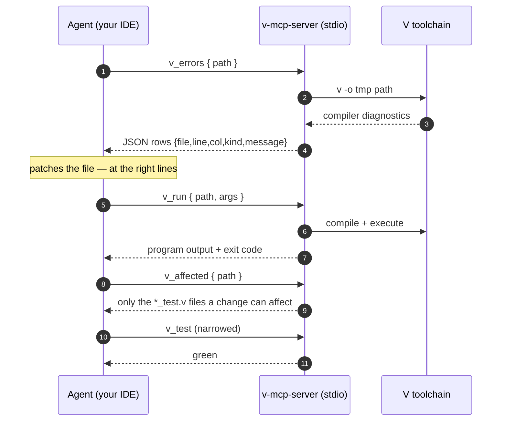

<div align="center">

# v-mcp-server

**Give your coding agent real V powers.** Compile errors, program runs,
structured diagnostics, smart test selection, repo maps — over the
[Model Context Protocol](https://modelcontextprotocol.io) (MCP).

[](https://github.com/gil-silva/v-mcp-server/actions/workflows/ci.yml)


*Vibes-driven coding is optional. Compiler-driven comes free.*

</div>

---

## What is this, in two sentences?

MCP is the protocol that lets coding agents (Claude Code, OpenCode, Zed and
friends) safely call outside tools while they work. This program is an MCP
"server": a small helper your agent starts in the background, which answers
requests like *"what errors does the compiler give for this project?"*.

Think of it as a USB port on your computer — only it plugs agents into the
V toolchain instead of a mouse.

## The loop it turns on

Before: an agent in your repo has to guess what "wrong" looks like in V —
*vibes-driven* editing. After: every change closes a compiler-verified loop.



## Install & connect in three minutes

**1. Have V (from source, current `master`).** The V project's own recipe is
two commands:

```bash
git clone --depth 1 https://github.com/vlang/v && cd v && make
# then put the freshly built ./v on your PATH
```

**2. Build the server once:**

```bash
v install gil-silva.vrepo gil-silva.vaffected
cd v-mcp-server
v .        # builds bin/v-mcp-server
```

<details>
<summary><b>Or install from the V package registry (no clone)</b></summary>

Published on vpm as <b><code>gil-silva.vmcpserver</code></b>:

```bash
v install gil-silva.vmcpserver
cd ~/.vmodules/gil_silva/vmcpserver && v .
```

Same program; `v install` just places the source under `~/.vmodules`.
</details>

**3. Connect your agent — once, one command, zero arguments:**

<details open>
<summary><b>Claude Code</b></summary>

```bash
claude mcp add vlang -- /home/<you>/vlang/v-mcp-server/bin/v-mcp-server
```
</details>

<details open>
<summary><b>OpenCode</b></summary>

```jsonc
// ~/.config/opencode/opencode.json
{
  "mcp": {
    "vlang": {
      "type": "local",
      "command": ["/home/<you>/vlang/v-mcp-server/bin/v-mcp-server"]
    }
  }
}
```
</details>

<details>
<summary><b>Zed</b></summary>

Zed's settings key is `context_servers` — same one-liner shape as the JSON
above, with the `command` array pointing at `bin/v-mcp-server`. (Exact JSON
shapes drift between releases; check your client's docs if the snippet is
rejected.)
</details>

Check it works (recommended):

```bash
v test .           # <1 min: builds the server, then talks to it like an agent
v run smoke.vsh    # prints a full agent-style session; ends with ✓ smoke passed
```

That's it. A terminal is the only other requirement — your agent starts the
server itself when it connects; you never run it by hand.

## Ask your agent (the fun part)

Open your agent in any V project and just ask normal things:

> *"Is everything formatted in src/?"*
> → `v_fmt_check`

> *"This build is failing and I can't tell why."*
> → `v_build`, reads the diagnostics, fixes the file

> *"Show me the failing spots as data."*
> → `v_errors` — JSON rows with exact `file/line/col`, no prose to decode

> *"Run my program with these two seeds and show me what it prints."*
> → `v_run` — one call: compile, execute, output

> *"What types and functions live in editor.v?"*
> → `v_symbols` — outline instead of reading 2,000 lines

> *"Orient yourself in this repo first."*
> → `v_repo_brief` — a map instead of file-by-file paging

> *"Only re-run what this refactor can actually break."*
> → `v_affected` — the moved-import graph decides test scope

## Token & time economy — by construction

No benchmark inflation here: these are structural guarantees (caps and
one-call patterns), so the savings show up in your context every session.

| Agent habit without it | With the server | Where the tokens go |
|---|---|---|
| page through files to orient | one `v_repo_brief` call, ≤ ~40k chars for a whole repo map | N file reads → 1 |
| run the full test suite after every small change | `v_affected` lists only the tests the change can reach | suite size → changed-file size |
| megabyte tool dumps pollute the conversation | every output hard-capped (100 kB) | bounded context, always |
| fuzzy prose errors, re-read the whole file | `v_errors` JSON rows: `{file,line,col,kind,message}` | seek-style edits |
| shell-out: compile, then run, disentangle streams | `v_run` one call; compile failure vs runtime exit kept distinct | 1 round trip |
| a hung child wedges the whole tool queue | every spawned process capped at 600 s (SIGTERM → SIGKILL); calls keep flowing | never blocked |

## Tools reference

| Tool          | Arguments | What it does |
|---------------|-----------|--------------|
| `v_build`     | `{path}`  | compiles and returns compiler diagnostics |
| `v_run`       | `{path, args?}` | compiles `path`, executes the binary; optional `args` (JSON array of strings) become the program's argv, output returned |
| `v_errors`    | `{path}`  | compile-only; diagnostics as JSON `[{file,line,col,kind,message}]` — `[]` means clean |
| `v_test`      | `{path}`  | runs `v test` |
| `v_fmt_check` | `{path}`  | `v fmt -c` — check only, never touches files |
| `v_vet`       | `{path}`  | `v vet` warnings |
| `v_ast`       | `{path}`  | `v ast -p` AST JSON (output capped at 100 kB) |
| `v_symbols`   | `{path}`  | outline of fns/structs/interfaces/enums/consts/types + line numbers |
| `v_deps`      | `{path}`  | name/version/license/dependencies from `v.mod` |
| `v_repo_brief`| `{path}`  | compact repo map: module identity, entry points, tree with LOC, per-file symbol outlines (~40k char cap) |
| `v_affected`  | `{path, base?}` | `*_test.v` files a change can affect: git diff vs `base` (default `HEAD`), propagated through the static import graph |

All tools expect **absolute** paths (e.g. `/home/you/vlang/vzed`), because
the server doesn't know which folder your agent was opened in.

## Troubleshooting

<details>
<summary><b>"command not found" / agent can't connect</b></summary>
Check the path you registered — it must point at
<code>bin/v-mcp-server</code>, not the project folder.
</details>

<details>
<summary><b>"no v.mod in ..." from <code>v_deps</code></b></summary>
You pointed it at a folder without a <code>v.mod</code>, or a <i>file</i>
instead of a folder.
</details>

<details>
<summary><b>Tool outputs look truncated</b></summary>
Intentional cap (100 kB) so huge outputs don't drown the conversation; ask
for a more specific file.
</details>

<details>
<summary><b>Server shows old tools after code changes</b></summary>
Rebuild (`v -o bin/v-mcp-server -no-parallel .`) and force the client to
re-spawn the binary — touch the config file or run <code>/mcps</code>.
A failed spawn can leave the connection marked failed until a fresh
connect.
</details>

## Notes for the curious

- Built on the official [`vlib/mcp`](https://github.com/vlang/v) module
  (protocol revision `2025-11-25` by default; stdlib handles switching).
- stdout is reserved for the protocol; all logs go to stderr.
- The V mascot outside: **Veasel**, by
  [vlang/v-mascot](https://github.com/vlang/v-mascot)
  (CC [BY-NC 4.0](https://creativecommons.org/licenses/by-nc/4.0/) — a
  chibi variant may still join this README).
- The two libraries it leans on, [`vrepo`](https://github.com/gil-silva/vrepo)
  (repo briefs) and
  [`vaffected`](https://github.com/gil-silva/vaffected) (affected-test
  graph), are published on vpm and usable without MCP.
- License: MIT (see [LICENSE](LICENSE)).
