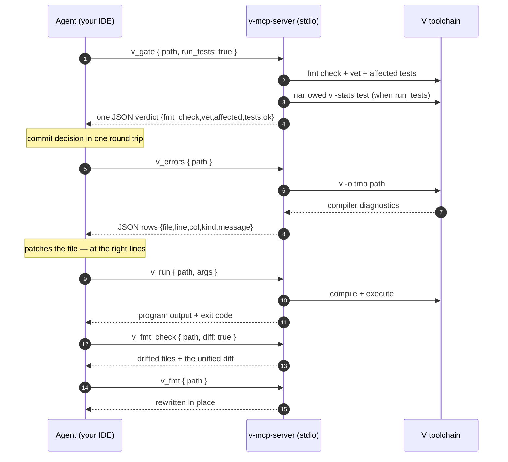

<div align="center">

# v-mcp-server

**Give your coding agent real V powers.** Compile errors, structured
diagnostics, program runs, in-place formatting, smart test selection, a
one-call commit gate, repo
maps, symbol source reads, v.mod project lookup, module docs — over the
[Model Context Protocol](https://modelcontextprotocol.io) (MCP).

A warm build cache rides along: identical sources, flags and toolchain skip
the compiler entirely.

[](https://github.com/gil-silva/v-mcp-server/actions/workflows/ci.yml)


*Stop guessing. Compile-verify every change.*

</div>

---

## What is this, in two sentences?

MCP is the protocol that lets coding agents (Claude Code, OpenCode, Zed and
friends) safely call outside tools while they work. This program is an MCP
"server": a small helper your agent starts in the background, which answers
requests like *"what errors does the compiler give for this project?"*.

Think of it as a USB port on your computer — only it plugs agents into the
V toolchain instead of a mouse.

## The loop it turns on

Before: an agent in your repo has to guess what "wrong" looks like in V —
*guess-and-pray* editing. After: every change closes a compiler-verified
loop.



## Install & connect in three minutes

**1. Have V (from source, current `master`).** The V project's own recipe is
two commands:

```bash
git clone --depth 1 https://github.com/vlang/v && cd v && make
# then put the freshly built ./v on your PATH
```

**2. Build the server once:**

```bash
v install gil-silva.vrepo gil-silva.vaffected gil-silva.vuses
cd v-mcp-server
v .        # builds bin/v-mcp-server
```

<details>
<summary><b>Or install from the V package registry (no clone)</b></summary>

Published on vpm as <b><code>gil-silva.vmcpserver</code></b>:

```bash
v install gil-silva.vmcpserver
cd ~/.vmodules/gil_silva/vmcpserver && v .
```

Same program; `v install` just places the source under `~/.vmodules`.
</details>

**3. Connect your agent — once, one command, zero arguments:**

<details open>
<summary><b>Claude Code</b></summary>

```bash
claude mcp add vlang -- /home/<you>/vlang/v-mcp-server/bin/v-mcp-server
```
</details>

<details open>
<summary><b>OpenCode</b></summary>

```jsonc
// ~/.config/opencode/opencode.json
{
  "mcp": {
    "vlang": {
      "type": "local",
      "command": ["/home/<you>/vlang/v-mcp-server/bin/v-mcp-server"]
    }
  }
}
```
</details>

<details>
<summary><b>Zed</b></summary>

Zed's settings key is `context_servers` — same one-liner shape as the JSON
above, with the `command` array pointing at `bin/v-mcp-server`. (Exact JSON
shapes drift between releases; check your client's docs if the snippet is
rejected.)
</details>

Check it works (recommended):

```bash
v test .           # ≈1 min: builds the server, then talks to it like an agent
v run smoke.vsh    # prints a full agent-style session; ends with ✓ smoke passed
```

That's it. A terminal is the only other requirement — your agent starts the
server itself when it connects; you never run it by hand. After connecting,
ask *which server build are you running?* — `v_server_info` answers with the
name, version and build timestamp baked into the binary.

## Ask your agent (the fun part)

Open your agent in any V project and just ask normal things:

> *"Is everything formatted in src/?"*
> → `v_fmt_check`

> *"This build is failing and I can't tell why."*
> → `v_build`, reads the diagnostics, fixes the file

> *"Build it with `-prod` and clang."*
> → `vflags` on `v_build`/`v_run` — CLI flags passed through, no raw shell

> *"Show me the failing spots as data."*
> → `v_errors` — JSON rows with exact `file/line/col`, no prose to decode

> *"Pipe this payload into my CLI and see what it prints."*
> → `v_run` with `stdin` — piped verbatim, no trailing newline, EOF afterwards

> *"Run my program with these two seeds and show me what it prints."*
> → `v_run` — one call: compile, execute, labeled stdout/stderr

> *"How does V actually resolve this option/result edge case?"*
> → `v_scratch` with `code` — a standalone snippet compiled and run, fenced off from your project

> *"This suite is huge — don't kill it halfway."*
> → `timeout` on `v_run`/`v_test`/`v_errors` — a bigger per-call cap (1..1800 s, default 600)

> *"Format every file you touched."*
> → `v_fmt` — closes the loop `v_fmt_check` opens (it only verifies)

> *"What types and functions live in editor.v?"*
> → `v_symbols` — outline instead of reading 2,000 lines

> *"What does this module document?"*
> → `v_doc` — the generated `v doc` output instead of paging raw source

> *"Orient yourself in this repo first."*
> → `v_repo_brief` — a map instead of file-by-file paging

> *"Only re-run what this refactor can actually break."*
> → `v_affected` — the moved-import graph decides test scope

> *"Re-run just `test_parse_fn`."*
> → `v_test` with `only:"*parse_fn*"` — a `VTEST_ONLY_FN` glob narrows the suite to one function

> *"Re-run just the files v_affected listed, not the whole directory."*
> → `v_test` with `files:"parse_test.v,cache_test.v"` — a `VTEST_ONLY` filter narrows the suite by file

> *"Who calls this function — and what implements this interface?"*
> → `v_uses` — definitions, call sites with their enclosing fn, and
> name-approximated implementers, with every section that has hits

> *"Is the vlang server you're using current?"*
> → `v_server_info` — version, build timestamp and `v -version`, no arguments

> *"Read just `parse_diagnostics`'s body, not the whole file."*
> → `v_read` — the exact symbol source, with its line range in the file

> *"Which V projects live under ~/vlang?"*
> → `v_where` — every `v.mod` project beneath it, with each module's facts

> *"Show me failing tests with timings as rows."*
> → `v_test` with `stats:true` — `[{file,name,ok,ms,asserts}]`, detail trailing

## Token & time economy — by construction

No benchmark inflation here: these are structural guarantees (caps and
one-call patterns), so the savings show up in your context every session.

| Agent habit without it | With the server | Where the tokens go |
|---|---|---|
| page through files to orient | one `v_repo_brief` call, ≤ ~40k chars for a whole repo map | N file reads → 1 |
| run the full test suite after every small change | `v_affected` lists only the tests the change can reach | suite size → changed-file size |
| rerun the whole suite to chase one flaky test | `v_test {only:"*fn*"}` selects test functions (`VTEST_ONLY_FN`, via `env(1)`) | suite runtime → one function |
| megabyte tool dumps pollute the conversation | every output hard-capped (100 kB) | bounded context, always |
| fuzzy prose errors, re-read the whole file | `v_errors` JSON rows: `{file,line,col,kind,message}` | seek-style edits |
| shell-out: compile, then run, disentangle streams | `v_run` one call; compile failure vs runtime exit kept distinct, streams labeled | 1 round trip |
| drop to the raw CLI for build flags (`-prod`, `-cc clang`) | `vflags` on `v_build`/`v_run`, passed verbatim to the v CLI | no shell detours |
| a hung child wedges the whole tool queue | every spawned process capped at 600 s (SIGTERM → SIGKILL); calls keep flowing; a call can raise its own cap with `timeout` (≤ 1800 s) | never blocked |
| guess V language semantics from memory, ship the bug | `v_scratch` compiles & runs a standalone snippet plain — no project wrap | verified answers, 1 call |
| rebuild after every edit call, waiting seconds each time | warm build cache: identical sources+flags+toolchain replay the stored build | compile seconds → ms |
| read a whole file to see one function | `v_read` returns just that symbol's source, with its line range | N file reads → 1 |
| dig through raw test text for the failures | `v_test` `stats:true` rows `[{file,name,ok,ms,asserts}]`, detail trailing | prose → data |

## Tools reference (19 tools)

| Tool          | Arguments | What it does |
|---------------|-----------|--------------|
| `v_build`     | `{path, vflags?}` | compiles and returns compiler diagnostics; optional `vflags` (JSON array of strings) is forwarded verbatim to the V CLI (e.g. `-g`, `-prod`, `-cc clang`, `-d flag`); warm-cached for identical inputs |
| `v_run`       | `{path, args?, stdin?, timeout?, vflags?}` | compiles `path`, executes the binary (or the cached one); optional `args` (JSON array of strings) become the program's argv, optional `stdin` (string) is piped to the program verbatim (no trailing newline added, EOF afterwards); with no `stdin`, a stdin-reading program sees EOF immediately, optional `timeout` (integer seconds, 1..1800, default 600) raises each step's cap, optional `vflags` are forwarded to the compiler, output returned with stdout/stderr labeled |
| `v_scratch`   | `{code, stdin?, vflags?}` | compiles and runs a standalone snippet, no project scaffolding — `code` is the complete source, a program with `fn main` or plain top-level statements (V script mode); optional `stdin` piped verbatim (no trailing newline, EOF afterwards), optional `vflags` to the compiler; identical snippets replay the warm cache; failure contract identical to `v_run` |
| `v_errors`    | `{path, vflags?, limit?, timeout?}`  | compile-only; diagnostics as JSON `[{file,line,col,kind,message}]` — `[]` means clean; optional `vflags` mirror the `v_build` command; optional `limit` (integer ≥ 1) caps the rows at the first N — when longer lists exist the reply is an object `{rows,total,truncated:true}` instead of the array; optional `timeout` (integer seconds, 1..1800, default 600) raises the compile cap |
| `v_test`      | `{path, only?, files?, stats?, timeout?}` | runs `v test`; optional `only` is a test-function glob forwarded as `VTEST_ONLY_FN` (via `env(1)`); optional `files` is a test-file filter forwarded as `VTEST_ONLY` — comma-separated patterns matched as substrings of each test file's path relative to `path`, pairing with the `v_affected` output; optional `stats` returns structured rows `[{file,name,ok,ms,asserts}]` with the raw output trailing as failure detail; optional `timeout` (integer seconds, 1..1800, default 600) raises the whole-run cap |
| `v_gate`      | `{path, base?, run_tests?}` | the one-call commit gate: `v fmt -c` (drift names the files), `v vet` (findings Surface as detail; only non-zero exits block), the affected `*_test.v` subset (git diff vs `HEAD`, or `base`), and — under `run_tests:true` — the affected tests executed as a narrowed `v -stats test` run. One JSON reply `{fmt_check,vet,affected,tests_run,tests,ok}`; the tool is an error result while `ok=false` |
| `v_fmt_check` | `{path, diff?}`  | `v fmt -c` — check only, never touches files; optional `diff` (boolean) appends the unified diff of what `v fmt` would change (ANSI-stripped), error result while drift exists |
| `v_fmt`       | `{path}`  | `v fmt -w` — format in place (mutates files) |
| `v_vet`       | `{path}`  | `v vet` warnings |
| `v_ast`       | `{path}`  | `v ast -p` AST JSON (output capped at 100 kB) |
| `v_symbols`   | `{path}`  | outline of fns/structs/interfaces/enums/consts/types + line numbers |
| `v_doc`       | `{path}`  | `v doc` — generated module documentation for a module directory |
| `v_deps`      | `{path}`  | name/version/license/dependencies from `v.mod` |
| `v_repo_brief`| `{path}`  | compact repo map: module identity, entry points, tree with LOC, per-file symbol outlines (~40k char cap) |
| `v_affected`  | `{path, base?}` | `*_test.v` files a change can affect: git diff vs `base` (default `HEAD`), propagated through the static import graph |
| `v_uses`      | `{path, symbol}` | who-uses-what for a declared symbol: definitions (`file:line` per kind), call/constructor sites with the enclosing fn/method, and — when the symbol names an interface — approximated implementing types; comments/strings scrubbed |
| `v_read`      | `{path, symbol}` | the exact source of one declared symbol (path = a .v file), from its header to just before the next declaration, with its `file:line-range` |
| `v_where`     | `{path}` | every V project (a folder holding a `v.mod`) under directory `path`, up to a few levels deep, each with its name/version/license/dependencies |
| `v_server_info` | — | the running build: name, version, compile-time build timestamp, and the underlying `v -version` — one call to spot a stale binary |

All tools expect **absolute** paths (e.g. `/home/you/vlang/vzed`), because
the server doesn't know which folder your agent was opened in — and every
tool validates that up front, returning a clear error for relative or
nonexistent paths instead of a cryptic compiler stream.

## Troubleshooting

<details>
<summary><b>"command not found" / agent can't connect</b></summary>
Check the path you registered — it must point at
<code>bin/v-mcp-server</code>, not the project folder.
</details>

<details>
<summary><b>"no v.mod in ..." from <code>v_deps</code></b></summary>
You pointed it at a folder without a <code>v.mod</code>, or a <i>file</i>
instead of a folder.
</details>

<details>
<summary><b>Tool outputs look truncated</b></summary>
Intentional cap (100 kB) so huge outputs don't drown the conversation; ask
for a more specific file.
</details>

<details>
<summary><b>Server shows old tools after code changes</b></summary>
Rebuild (`v -o bin/v-mcp-server -no-parallel .`) and force the client to
re-spawn the binary — touch the config file or run <code>/mcps</code>.
A failed spawn can leave the connection marked failed until a fresh
connect. To see which build is actually running, ask the agent for
<code>v_server_info</code> (name, version, build timestamp).
</details>

## Notes for the curious

- Built on the official [`vlib/mcp`](https://github.com/vlang/v) module
  (protocol revision `2025-11-25` by default; stdlib handles switching).
- stdout is reserved for the protocol; all logs go to stderr.
- The warm build cache lives under `$TMPDIR/mcp_vlang_cache`, one entry per
  distinct build key (toolchain version + realpath + vflags + content hashes
  of the `.v` sources in scope and their `v.mod`). A hit means byte-equal
  inputs — the compiler doesn't run. At server start the store is pruned to
  the newest 16 entries (everything older than 14 days first).
- The V mascot outside: **Veasel**, by
  [vlang/v-mascot](https://github.com/vlang/v-mascot)
  (CC [BY-NC 4.0](https://creativecommons.org/licenses/by-nc/4.0/) — a
  chibi variant may still join this README).
- The three libraries it leans on,
  [`vrepo`](https://github.com/gil-silva/vrepo) (repo briefs),
  [`vaffected`](https://github.com/gil-silva/vaffected) (affected-test
  graph) and
  [`vuses`](https://github.com/gil-silva/vuses) (who-uses-what: definitions,
  callers, interface implementations), are published on vpm and usable
  without MCP.
- License: MIT (see [LICENSE](LICENSE)).
